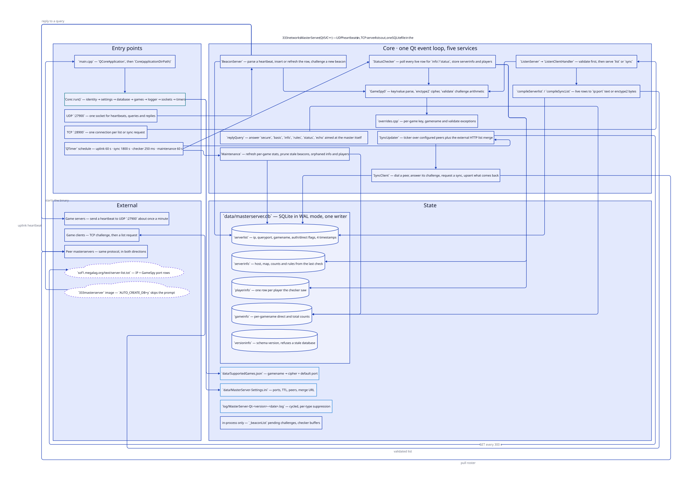

# Masterserver-Qt5 — for humans

> A GameSpy v0 master server: game servers send UDP heartbeats to `:27900`, game clients fetch a validated TCP server list from `:28900`, and one SQLite file holds the roster that both sides agree on.

Read it left to right:

- **Entry points** — `main.cpp` does almost nothing: it builds `Core` with the binary's directory and hands control to `Core::run()`. That function is a strict gate: no settings file, no database, no supported games or no logger, and the process exits before a single socket opens. Every optional service is then switched on by one ini flag (`DoUplink`, `DoSync`, `DoMerge`, `DoCheck`, `DoMaintenance`), so the same binary is both a tiny beacon receiver and a full 333networks node.
- **Core** — five independent services share one Qt event loop. `BeaconServer` listens for heartbeats, `ListenServer`/`ListenClientHandler` answers list requests, `SyncClient` pulls peers, `StatusChecker` polls individual game servers, and `Maintenance` prunes. Nothing calls anything else directly; they meet in the database and in `GameSpy0`, which owns the key/value parsing, the `validate` challenge math and the `enctype2` cipher.
- **A heartbeat is trusted before it is validated** — the first heartbeat is written to `serverlist` straight away and only *then* does the master send a `secure` challenge, flipping `f_auth` when the answer checks out. A failed validation does not delete the row. Treat `f_auth = 0` as "claimed, not proven"; the checker later re-challenges synced rows for exactly this reason.
- **State** — the whole roster lives in `data/masterserver.db` (SQLite, WAL, one connection). `serverlist` is the address book (`dt_beacon`, `dt_sync`, `dt_updated` timestamps plus `f_direct`/`f_auth` flags), `serverinfo` and `playerinfo` are only what the checker scraped last time, and `gameinfo` is the per-game count the master reports about itself. `ServerLifeTime_s` is the only thing that makes a server "offline": a row stays until maintenance removes it.
- **External** — sync is symmetric and uses the same port as clients: peers dial `:28900`, get challenged, and ask for `\sync\`. The external HTTP list is different — it imports *only* IP and GameSpy port and stamps one configured gamename on every row, so those entries carry no authentication of their own. The checker's queries leave from `BeaconPort + 1` (27901): reserve it, but do not port-forward it.

Source: [`docs/system.d2`](docs/system.d2). Edit that, then run [`scripts/render-diagram.sh`](scripts/render-diagram.sh).
